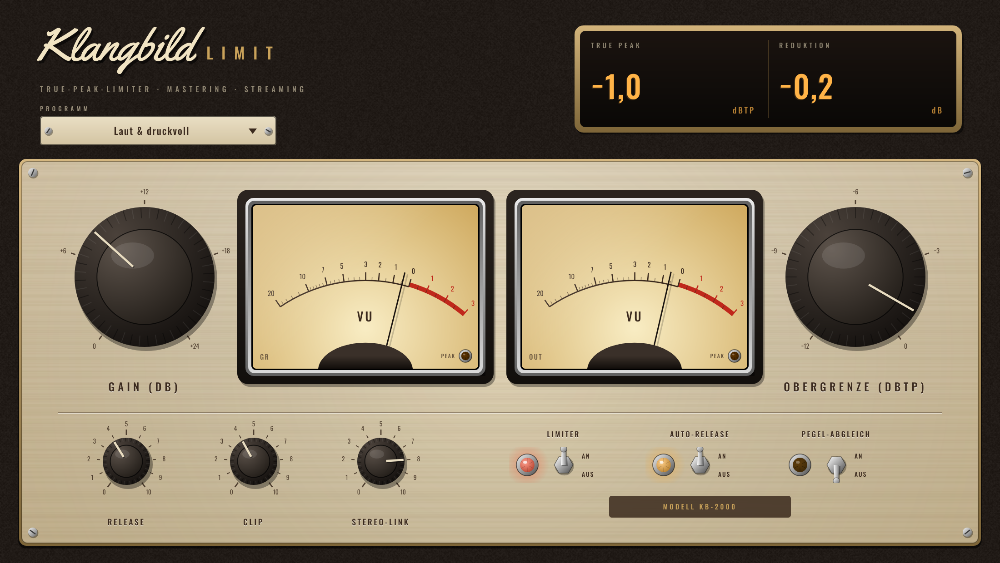

# Klangbild Limit

True-Peak-Limiter fürs Mastering im Vintage-Look – macht den Song laut, ohne dass Spitzen
(auch zwischen den Abtastwerten) über die eingestellte Obergrenze gehen. Audio Unit für Logic Pro
(außerdem VST3 und Standalone), gebaut mit [JUCE](https://juce.com).



## Bedienung

| Regler | Wirkung |
|---|---|
| **Gain** | wie weit das Signal in den Limiter gefahren wird (0 … +24 dB) – mehr = lauter |
| **Obergrenze** | höchster erlaubter True Peak (−12 … 0 dBTP). Für Streaming: **−1 dBTP** |
| **Release** | wie schnell der Limiter wieder loslässt (10 … 1000 ms) |
| **Clip** | weicher Clipper vor dem Limiter (4-fach überabgetastet) – nimmt kurze Spitzen wie Snare-Schläge sanft weg, für mehr Lautheit bei weniger Pumpen |
| **Stereo-Link** | 100 % = beide Seiten gleich geregelt (stabiles Stereobild) |
| **Limiter An/Aus** | weicher Bypass, zeitrichtig; aus = Signal bitgenau |
| **Auto-Release** | kurze Spitzen: schnell zurück – dauerhafte Lautheit: langsam zurück (weniger Pumpen und Verzerrung) |
| **Pegel-Abgleich** | nimmt das Gain am Ausgang wieder heraus – du hörst ehrlich, was der Limiter am Klang ändert, ohne „lauter = besser“-Täuschung |

**Anzeigen:** links die Pegelreduktion (Zeiger wandert von 0 nach links), rechts der Ausgang.
Oben **TRUE PEAK** (höchster Wert, 3 s gehalten, Klick setzt zurück – rot bei Überschreitung) und **REDUKTION**.

### Presets
Standard · Streaming (−1 dBTP) · Transparent · Laut & druckvoll · Clipper-Stil · Sicherheitsnetz · Demo/Probe laut

## Technik
- Vorausschau 2 ms, Pegelregelung mit garantiertem Einsatz *vor* der Spitze
- True-Peak-Erkennung 4-fach plus feine zweite Stufe mit 8-fach-Erkennung
- Ohne Clip läuft das Signal unverändert durch (kein Oversampling-Filter im Weg)
- Latenz 5,9 ms bei 48 kHz – wird an Logic gemeldet und automatisch ausgeglichen

### Messwerte
| Test | 44,1 kHz | 96 kHz |
|---|---|---|
| Musik, Gain +12 dB, Obergrenze −1 → True Peak (unabhängig 8-fach gemessen) | −1,00 dBTP | −1,00 dBTP |
| Gain +18 dB, Obergrenze −0,3 | −0,30 dBTP | −0,30 dBTP |
| Sinus fs/4, 45° (Spitzen nur zwischen den Abtastwerten) | −1,00 dBTP | −1,00 dBTP |
| Signal unter der Obergrenze | bitgenau | bitgenau |

Release 30/120/500 ms → 90 % erholt nach 48/193/760 ms.
Auto-Release: nach einer 5-ms-Spitze nach 50 ms fast vollständig zurück (−1,1 dB statt −3,4 dB mit festem Release).

## Tipp für die Mastering-Kette
**Klangbild Band → Klangbild EQ → Klangbild Bus → Klangbild Limit** (immer als Letztes).
Gain so weit aufdrehen, bis die Reduktion bei lauten Stellen etwa 2–4 dB zeigt; mit Pegel-Abgleich gegenhören.

## Installation in Logic Pro

Tab **Actions** → letzter grüner Lauf → **Artifacts** → `Klangbild-Limit-macOS`, dann:

1. `Klangbild-Limit-AU.zip` entpacken → `Klangbild Limit.component`
2. Finder → ⇧⌘G → `~/Library/Audio/Plug-Ins/Components` → Datei hineinkopieren
3. Einmal im Terminal:
   ```
   xattr -dr com.apple.quarantine ~/Library/Audio/Plug-Ins/Components/"Klangbild Limit.component"
   ```
4. Logic starten: **Audio Units → Klangbild → Klangbild Limit**

## Lizenzen

Schriften *Oswald* (OFL 1.1) und *Yellowtail* (Apache 2.0) – Lizenztexte in `Resources/`.
JUCE: AGPLv3 bzw. kommerziell – für den privaten Gebrauch unproblematisch.
